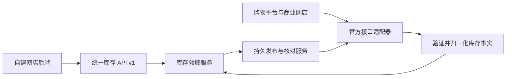

# 网店与平台接入规范

> 版本：1.0 设计草案 · 日期：2026-10-07。目标是接入方便、协议一致、权限可控。当前没有已运行连接器或生产 API。新增实现选择待设计评审，首期仍为 Acuven 自营单地点库存，不提前实现 SaaS。

## 1. 设计目标与边界

一个新网店应能从接入包知道：支持哪些动作、如何取得本店规格映射、怎样预留和提交库存事实、未知结果如何查询、权限不足与故障怎样区分。新增渠道只增加连接配置和必要的适配器，库存公式、去重和出入库规则不为某个平台另写一份。

| 关注点 | 可验收目标 |
| --- | --- |
| 方便性 | 已有合格适配器的店铺按连接向导配置；自建网店后端按统一契约接入；获得机器可读契约、示例、模拟数据与故障测试清单。 |
| 规范性 | 数量、引用、错误、幂等、版本、能力状态和启用流程统一；外部平台的差异由适配器明确转换。 |
| 安全性 | 身份绑定连接与部署环境，所有对象和动作检查权限；外部账户密钥由后端保管；操作可撤销、审计和限流。 |

“方便接入”需要网店自身提供可用的后端/API 或安装经过验证的适配器。未知商业网店不能只输入网址就自动完整接通；不提供任意 URL 抓取、上传并执行插件代码或绕过购物平台审批的入口。

## 2. 两条接入路径



### 2.1 自建网店：reserve_api

Acuven Shop 是第一个调用方。正常结账由网店后端调用 Inventory 原子预留，付款成功、取消、出库、实物验收分别发送最小事件。其他自建网店实现同一协议，不共享数据库，不引用 Shop 内部表名。

接入包提供“查询身份和能力 → 读取已确认映射 → 查本店可售 → 整单预留 → 确认事实 → 查处理结果”的完整步骤。网店后端保留自己的订单和 outbox；库存查询快照不能代替预留。Inventory 当前选定的临时故障继续收款政策仅是 Acuven Shop 的已确认行为，不作为所有未来客户网店的默认策略；新增网店须单独声明、评审其故障销售政策。

### 2.2 购物平台/商业网店：platform_adapter

不能控制其结账流程的平台，不伪装成 reserve_api。适配器获取店铺官方授权、规格/库存及影响库存的销售事实，转成同一库存动作；按该平台实际能力发布绝对可售目标并核对。

平台应用级凭据由后端配置；每个店铺保存独立店铺授权及状态。平台作用域、仓库语义、促销限制、剩余/总库存口径、API 版本、限流、销售事件和自动回补行为必须逐项验证。同一平台新增店铺复用适配器，但仍单独审核映射、份额和授权。

授权成功、库存写入成功和完整库存自动同步是三个不同完成点。没有可靠销售事实、回读和写入核对能力时，只开放已验证只读/人工功能，不启用自动调配。

### 2.3 未获批/不完整接入：manual_quota

只处理已隔离人工份额、最小销售登记和待办，不称实时同步。首期 Shopee 的人工核对、逾期仅后台提醒、持续销售及增配限制沿用既有需求；后续网店不得随意将人工份额转入自动池。

## 3. 连接模型与能力发现

每个部署有不可变 `instance_id`，每个租户/库存池/地点及目录/账实例有可信引用，每家店铺/网店有独立 `connection_id`。后端保存 `profile`、平台/店铺 ID、固定归属、环境、契约版本、映射版本、连接生命周期及能力核验证据；服务身份仅绑定一个连接，可用多个作用受限的凭据。适配器执行上下文由系统取连接，不从外部正文决定归属。

连接生命周期：`draft → testing → active → draining → closed`。授权状态、能力状态、SKU 异常和通知是否确认分别存储，不塞进一个万能 status：

- draft/testing 不允许真实新预留或自动平台发布；用隔离 Demo 完成写入验证，生产测试阶段可进行明确受控的只读核对。
- active 仍需检查具体 capability、scope、映射和 SKU 状态。
- draining 拒绝新预留，保留切换清单中已登记事实；停止新销售接入的交接由原网店/平台运营落实。
- closed 拒绝写入；可为历史查询保留独立只读身份，撤销写入凭据。完全撤销身份后不再查询历史。

每项能力状态为 `not_supported / pending_approval / pending_verification / verified / temporarily_unavailable`，并保留核对时间/证据。标准能力如下：

| 能力 | 用途 | 启用条件 |
| --- | --- | --- |
| `mapping_read` | 读取当前身份可见的规格映射 | 管理员确认映射；服务身份不能自己建立或换实物 SKU。 |
| `availability_read` | 自身可售查询/公开状态 | 已生效份额及对应查询权限；异常返回未知/待核对。 |
| `reservation_write` | 自建网店预留与释放 | reserve_api、active、库存与身份条件正常。 |
| `event_sale/cancel/dispatch/return` | 各库存事实 | 对应动作权限、稳定引用与数量上限，存量处理仍遵守生命周期。 |
| `inventory_read/write` | 平台适配器官方读写 | 官方权限与语义验证、逐 SKU 结果可核对。 |
| `reconcile` | 漏事件/展示量与份额核对 | 已验证补拉窗口、游标、排序及去重；不能据一次 HTTP 成功认定可用。 |

不能让调用方自行提交 `profile=platform_adapter` 或 `verified=true` 跳过预留/人工核对。API 展示能力仅帮助客户端理解，服务端每次仍重新检查。

## 4. 运营连接向导

首期由 Acuven 管理员操作，不开放商户自助注册。计划的步骤：

1. 选连接类型，显示支持能力、适配器版本及未获批功能。
2. 自建网店生成该连接服务凭据；平台进入官方授权流程。密钥只显示一次，页面仅保留凭据 ID/末尾识别字符、权限及有效期；不是在同一字段显示完整秘密。
3. 读取/导入外部规格，下载固定列的映射表，逐项确认中心 SKU。外部稳定规格 ID 是主识别，名称不自动匹配。
4. 显示只读连接检查、映射数量、权限、过期和缺项。写入探测只在隔离测试数据上执行；“测试连接”按钮不得修改真实库存。
5. 核对盘点、旧占用、安全库存、份额、比例和未处理事实，保存启用预览。
6. 管理员确认后启用已核对 SKU，按规格保存结果。符合已有当天启用策略，不增加强制多日观察期。

向导不能自行停售店铺、覆盖平台库存或把新接入数据当作现货；会实际写库存的按钮明确展示连接、SKU、当前值与目标值。

### 4.1 映射导入格式

```csv
external_product_id,external_variant_id,external_seller_sku,acuven_sku_code
product-001,variant-001,SELLER-BLACK,ACV-EARPHONE-BLK
```

连接和环境由当前已验证管理会话决定，CSV 不含凭据、顾客或库存总数。处理编码/空值/重复/无效 ID，整批预览后确认，失败行不得偷偷生效；编辑不能覆盖已确认存量归属。同店同中心 SKU 一个生效规格的规则保持。表格导出对公式型单元格转义，SKU 自由文本不执行为公式或网页脚本。

## 5. 接入包及版本规范

采用固定 [OpenAPI 3.1.1](https://spec.openapis.org/oas/v3.1.1.html) 描述 HTTP 契约，供文档、客户端和验证工具读取。本轮保存的是设计契约，不是运行服务导出的已实现 API。

接入包：

- `contracts/inventory-v1.openapi.json`：设计 source of truth；路径、请求/响应、枚举、动作权限、示例和限额。
- [INTEGRATION_GUIDE](INTEGRATION_GUIDE.md)：最小接入步骤、配置项、调用例子及故障处理。
- `contracts/examples/connection.example.json`：不含凭据的能力发现响应。
- `contracts/examples/mappings.example.csv`：规格映射模板。
- 未来实施的模拟服务/一致性测试包：先覆盖状态与故障，不接真实店；CI 根据固定契约验证实际 Inventory 和 Shop。

首期先提供协议与 Acuven Shop 客户端；不发布多语言 SDK/任意插件商店。后续常用语言 SDK 从同一契约生成，业务重试封装必须按原引用/幂等规则实现，不能生成新键“解决”超时。

`/internal/v1` 的路径暂保留作服务到服务接口，名称不代表网络私有或可以免鉴权。文档命名为“网店服务 API”；只经受控 HTTPS 入口开放。运行时接口导出应与已评审设计比较，已发布前的实现差异先改设计并复审，不让代码导出自动覆盖约定。

API 契约版本 `1.0.0-draft.2` 与文档版本 0.8 独立。正式发布冻结请求/响应、枚举及权限语义；不兼容变更改主版本/路径，新增受支持能力要先通知并验证旧客户端。新增响应字段也要纳入消费端兼容测试，不能假设所有生成客户端都会忽略未知字段。

## 6. 服务权限与数据边界

[OWASP 对象级授权说明](https://api-security.owasp.org/editions/2023/en/0xa1-broken-object-level-authorization/)要求访问带 ID 的对象时检查相应权限。本项目把这落实为“实例/环境 → 连接 → 允许的对象 → 具体动作”的逐层校验，UUID 或知道某 SKU 编号不能作为访问授权。

| 身份 | 权限 | 不允许 |
| --- | --- | --- |
| 网店结账服务 | connection/mapping 只读、自身数量、预留/释放、销售确认、事件查询 | 管理员改现货、配额、映射、平台密钥和其他连接。 |
| 网店履约/售后服务 | 可按需要另授取消、出库、返库事实及查询 | 未经本地业务核实伪造履约；退款金额/执行不属于 Inventory。 |
| 顾客库存工具 | `availability:status` | 具体件数、预留、任何库存事实写入。 |
| 管理员 | 管理端身份，按个人账号操作 | 使用服务 key 冒充个人审计；在浏览器显示平台秘密。 |
| 平台适配器 | 服务器配置绑定的店铺及能力 | 从 webhook 正文自选连接；跨店使用刷新令牌。 |

所有操作统一使用 `connection:read`、`mapping:read`、`availability:read/status`、`reservation:read/write`、`event:read` 和动作 scopes `event:sale:write / event:cancel:write / event:dispatch:write / event:return:write`。不提供一个通用 event:write 作为默认全权限通行证。首期一个可信 Shop 后端可按实际需要组合权限，不要求增加无必要的微服务。

新可售查询/预留的 SKU 必须验证当前连接的生效映射；存量取消/出库/返库优先验证已登记订单行的原 SKU 与连接归属，不能因为当前映射改变就改扣新 SKU 或拒绝处理原事实。预留、订单行、事件都在同一连接内查询。同一批请求包含一个越权对象整批拒绝，不泄露其他项。网店服务不能取得入库、盘点、安全库存、配额调整或撤销其他连接的权限。

## 7. 凭据与官方授权

自建网店首期采用 HTTPS + 每连接独立随机 bearer 凭据，服务端只存摘要。Bearer 的保管和传输约束参考 [RFC 6750](https://www.rfc-editor.org/rfc/rfc6750.html)：不放 URL、localStorage、聊天或日志；不将其当顾客登录凭证。TLS 校验证书，不提供 ignore SSL 的接入选项。

创建凭据明确 scopes、环境、到期时间；建议初始有效期 90 天、到期前 14/7/1 天后台提醒，另按既有普通/严重规则通知。此为待评审技术参数；轮换验证新凭据后撤销旧凭据，默认最多 24 小时重叠，紧急泄露立即撤销。刷新/轮换不扩大权限或恢复已关闭连接。生产密钥不写接入指南示例。

平台 OAuth 按对应官方机制实现。对标准 OAuth 部分参考 [RFC 9700](https://www.rfc-editor.org/rfc/rfc9700.html)：固定精确回调、一次性 state、绑定环境/连接/管理员会话、禁止任意返回地址；在平台支持并要求时采用 PKCE，不声称所有购物平台协议相同。回调后向官方核对实际店铺归属和 scope，不能只相信浏览器传入 shop_id。管理员明确确认绑定店铺，授权码/token 不进入持久化 URL 日志。

平台令牌密文与加密 key 分离；加密 key 有版本/恢复方案。刷新按连接加互斥及版本校验，避免两个任务使用旧刷新令牌覆盖新令牌；授权失效后不靠重复刷新无限重试。解绑/撤权停止对应自动写入并留审计，保持历史事件，不自动清库存占用或停售。

安全边界承认服务 credential 持有方是可信网店后端；Inventory 能检查身份、动作和累计量，但不能单凭一个“退货收到”请求证明真实包裹已收到。实际验收/取消/交运的证据由原业务系统授权流程保证；异常来源频率或数量进入核对，不能把 API 鉴权成功视为事实真实性全部已证实。

## 8. 外部数据与请求保护

平台 webhook 原始字节按平台规定验签，匹配注册应用与店铺，再写入持久 inbox；不可先按任意正文里的 connection_id 路由。官方有时间签名窗口时校验；没有时不自造通用头，以真实事件/动作引用去重并官方补拉核验。重复投递返回适当确认，未持久保存不能假报成功。

外部 API 响应也校验字段、量纲、分页、响应大小和时间，错误或缺失不当作库存 0。[OWASP 不安全 API 消费](https://api-security.owasp.org/editions/2023/en/0xaa-unsafe-consumption-of-apis/)用于审查第三方响应边界，不能只校验我们的入站 JSON。批量平台接口逐 SKU 核验，HTTP 200 不代表全部成功。

首期不接受任意出站通知网址。平台 API 域名、OAuth token 地址等由审核适配器固定配置；未来要向其他网店推送库存通知，另设计 HTTPS 回调授权、签名和投递，防止任意 URL 访问内网、localhost、链路本地/云元数据地址，并验证 DNS/重定向目的地。[OWASP SSRF 说明](https://api-security.owasp.org/editions/2023/en/0xa7-server-side-request-forgery/)作为该边界依据。受控内部服务地址只由部署配置允许，不开放给接入方自由填写。

新回调若后续实现，只通知本连接受限库存状态/版本或已提交事件结果，消费者再认证查询；不传播全量库存或顾客资料，不把出站通知添加到首期依赖。

## 9. 限流、重试及发布顺序

API 限额按实例、连接、凭据、操作和并发控制；多个凭据仍共用连接预算，防止通过换 key 绕过限制。[OWASP 资源消耗说明](https://api-security.owasp.org/editions/2023/en/0xa4-unrestricted-resource-consumption/)用于界定请求大小、批量及执行时间上限；数值须按本项目压力测试调整，不是购物平台官方额度。

初始技术建议：每连接每分钟读取 120、预留/释放 30、事件接收 120、同时处理写请求 5；按 100 行/128 KiB 限制，并对连接有效预留总量和异常频率设受控运营预算。Shop 的每顾客/浏览器最多 3 笔限制仍由 Shop 实施；API key 不交浏览器。真实销售事件超限返回 429 且不假报接收，网店 outbox 必须保留并退避，Inventory 后台监测积压，不丢弃真实销售事实。

429 返回 Retry-After；同一业务重试使用原幂等键和事实引用。不同动作/对象的限流不得让一店拖垮其他店。平台出站预算按实测官方限额独立配置，刷新、读写及补拉互相保留必要预算。

平台库存发布按连接 + SKU 串行，job 固定目标版本，执行前废弃已被新版本替代且尚未发出的任务。结果未知时不盲目重发旧数量、不推进转移增量；先核对期间销售和平台当前量，计算新目标。晚到的旧响应只记录其原目标结果，不能将它标为最新版本已生效。无法可靠核实旧请求最终效果时，该 SKU 保持待核对，不自动调配；平台不支持条件写入时保留其竞态限制说明。

## 10. 连接器开发边界

每个连接器提供版本化清单：连接类型、协议/平台 API 版本、支持动作、必需官方权限、授权方式、固定端点、限额配置、库存口径、分页/补拉机制、错误转换、测试夹具和已核验证据。审阅清单后才能注册，管理员不能上传任意包执行代码。

适配器职责包含 `authorize/refresh`、`list_variants`、`read_stock`、`pull_facts`、`verify_webhook`、`normalize_facts`、`write_stock` 与 `capabilities`。结果统一为 `confirmed / rejected / unknown / unsupported`，保留脱敏外部请求引用和错误码；平台特有字段不进入库存核心。数量动作进入统一领域服务，发布/核对用同一持久作业机制。

未注册的外部实现不能直接运行在 Inventory 进程内。后续客户自建网店用服务 API 接入即可；如果其商业网店需要专用连接器，按已选择平台另开发并验证，不用一套通用爬虫充当所有连接器。

## 11. 一致性与安全验收

每个接入方都有版本化通过记录，至少验证：

| 类别 | 必需场景 |
| --- | --- |
| 身份 | A 凭据访问 B 的 SKU/预留/事件均拒绝；同订单号两连接不混淆；Demo 调真实服务失败。 |
| 动作权限 | 状态工具不能读数量；sale scope 不能提交取消/出库/退货；网店服务不能改现货/份额。 |
| 数量链 | 整单不足、并发最后一件、预留到期、取消/出库/返库上限、重复与乱序。 |
| 未知结果 | 创建响应丢失查询原订单；202 后处理失败；结果已应用但 needs_review；恢复后重放一次。 |
| 官方平台 | 错签/重复 webhook、授权过期、刷新竞态、库存口径/部分成功、平台自动扣量/回补、旧目标迟到。 |
| 资源 | 超批量、超请求体、越权混合批次、限流和事件积压；连接预算隔离。 |
| 版本 | 老消费端仍能使用已发布契约；新适配器只加配置/转换，核心公式不用修改。 |
| 启用 | 已核对映射/期初占用/份额及 capability 才真实写入；缺项明确显示，停用保留存量事实。 |

API schema 通过只证明格式；并发 MySQL、平台实测、授权及真实业务验收分别提供证据。SaaS 所有权、后台授权与存储访问需先设计并在外部生产前验证；当前连接隔离不能替代多商户隔离。

## 12. 首期与后续落地

库存与 AI 客服独立运行，CRM/ERP 采用未来独立业务集成身份与契约，见[SYSTEM_DECOUPLING](SYSTEM_DECOUPLING.md)。三种渠道 profile 仅描述销售接入；CRM/ERP 不自动变成有配额的店铺，也不默认继承 Shop 库存故障销售策略。

现行数量主责是共用 Core；Inventory 的平台事实入口和政策包装送 Core 处理，ERP 经同账业务契约收货/合法销售并读取结果，不产生第二账。见[现行决定](decisions/SHARED_COMMERCE_CORE.md)；旧[库存方向](decisions/ERP_INVENTORY_AUTHORITY.md)仅为历史。这不将当前 v1 包装接口声明为已实现 Core/ERP API。

首期：统一契约、身份/映射/能力发现、管理员连接向导、Acuven Shop 客户端、模拟一致性用例、已获批平台独立适配器。上线验收包括对象/动作权限、密钥轮换、未知发布结果和日志脱敏。

后续按实际需求：指定商业网店插件、常用语言 SDK、出站通知、机器 OAuth/mTLS、客户独立部署包。SaaS、插件商店、无限连接器和自助商户授权不提前交付。第一家外部试点接入时验证该店故障销售政策、维护责任及售后交接，再决定产品化范围。

## 13. 系统群修订的接入语义

本稿渠道三种 profile 继续用于 Inventory；核心单模块记账另用基础账 API。商品/基础数量由[共用核心](decisions/SHARED_COMMERCE_CORE.md)拥有，Inventory 维护跨入口政策与适配器。ERP 采购收货加一个销售入口不需 Inventory；两个入口同池销售需它，未购的 Shop/POS 不同池不能互借。

每个连接还绑定可信租户/池/地点及 Core 实例，SDK/正文不能自选这些上下文。Acuven Hub 门户集成只调用授权 API，模块本地/联邦身份、已购能力及限时支持 grant 在业务端重验；SaaS、专属、自托管分开验收。原“单商户未来 SaaS 再看”设计被明确产品形态取代，首个真实试点仍仅 Acuven。

完整原子接口、迁移、Demo 线索、ERP 汇总和开发门槛见[架构对齐](HUB_ARCHITECTURE_ALIGNMENT.md)。当前 v1 接入包是 Inventory wrapper 草案；尚无 Core 代码或基础 API，不据此承诺所有单模块已能运行。
