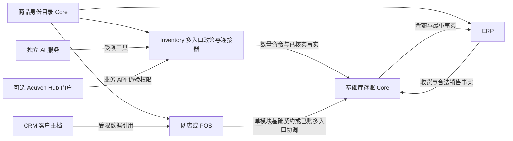

# 库存、AI 客服、CRM 与 ERP 的独立运行和集成边界

> 版本：1.0 补充设计草案 · 日期：2026-10-07。库存与 AI 客服独立运行，后续接 CRM、ERP。最新系统群修订为唯一共用目录/基础账，Inventory 负责多入口产品政策。CRM/ERP 接入、Core 抽离和部署仍待实现，不代表已接通。

## 1. 独立运行原则

Acuven Inventory 独立提供多入口后台、API、渠道规则、产品数据库和同步作业，随产品交付商品目录/基础账 Core；所有数量事实经同一独立 Core 服务处理。AI 客服是受限 API 调用方，启用它不作为库存系统启动、部署或完成库存事务的条件。

- Inventory 代码/依赖中不导入 Chatbot 的业务模块，不需要 LLM key、WhatsApp 凭据或 Chatbot 数据库才能运行。
- AI 客服通过自身的库存客户端访问版本化库存 API，端点/凭据由配置提供；替换客服实现只需要满足工具接口与身份边界。
- 各系统独立仓库、部署配置、数据库账号、服务身份和健康检查。共用主机/MySQL/Redis 是已选基础设施方式，进程、数据和代码仍分开；共享基础设施故障需要共同恢复设计。
- 不跨系统直接写数据库、不在启动时从别的服务导入 schema、不把跨服务调用放进持有库存数据库锁的事务。
- 库存平台的预留、入库、配额、事件处理和同步不调用 AI 才作决定；AI 辅助建议若后续增加，须保持可关闭和人工核对。

## 2. 调用方向

共享核心随模块交付，Inventory 单卖也附它；门户、AI、ERP 非 Inventory 单卖运行前置。组合模块经受控 API 使用同一目录/数量账，未购 Inventory 的两个入口不能据图共享一池。当前没有 Core 应用或已实现接口。

## 3. 数据负责方和标识

| 数据/动作 | 首期负责方 | 后续集成方式 |
| --- | --- | --- |
| 商品身份/基本名称/SKU/条码/参考价 | 商品目录 Core | 任一相关模块随附，同租户组合共用，不随加购切换主档。 |
| 实物/不可售、H/C、预留与基础流水 | 基础库存账 Core | 一池一账，ERP/Shop/POS/Inventory 提交合法事实只记一次。 |
| 安全库存与渠道份额/同步 | Inventory 政策，Core 原子执行 | 多销售入口共池授权和配额协调由 Inventory 产品提供；本地目标不等于账内生效。 |
| 渠道规格、SKU 对照 | Inventory 的审核映射 | 关联目录稳定规格 ID；ERP/Shop/POS 用同一目录，旧独立数据需一次映射，名称/参考价不能自动合并。 |
| Shop 账号、本人订单、支付、地址、售后 | Shop | CRM 可接所需客户/服务资料；ERP 可接所需订单/财务事实，具体数据契约在所属项目批准。 |
| 平台原订单和履约事实 | 原购物平台 | 适配器提取最小库存动作；ERP 的订单副本不再当新销售扣一次。 |
| CRM 客户档案、线索、商机、服务记录 | CRM，待设计 | 与 Shop 顾客 ID 建受控映射；Inventory 不复制姓名、电话、地址或聊天记录。 |
| ERP 采购、供应商、成本、会计、发票 | ERP，待设计 | Inventory 可按权限接实际到货/出库等必要库存事实；金额及单据归 ERP。 |
| 对话、工具编排、人工转接 | AI 客服及网关 | 独立工具客户端和最小权限；后台业务规则仍由目标服务执行。 |

各系统保留自己的稳定 ID，集成层维护对照、版本与来源；不要求所有系统共用一个数据库主键。Shop 订单认领仍按既定身份核验；CRM 电话相同、联系人合并或营销授权不能直接授予本人订单访问权。

## 4. 店铺连接与业务系统集成分开

现有 connection_id 表示一个销售网店/店铺，携带渠道份额。AI 客服是该连接的受限查询身份，不因为加一个客服客户端就分配一份库存。

CRM 及客户外部 ERP 采用 integration_id/受限业务身份；Acuven ERP 是共用 Core 的正式业务调用方。它们不自动成为销售渠道，不为 ERP、CRM 建立 Shopee 一样的 Q 配额，也不通过创建假网店取得全局库存访问。

业务集成身份保存目标部署/归属、系统类型、允许的数据范围、动作、版本、有效期及撤销状态。CRM 的客户工具、ERP 财务工具凭据不能拿来操作 Inventory；每个目标服务有自己的权限检查。

Inventory v1 面向已购多入口产品的网店及受限状态调用，基础数量动作由 Core 执行。自家 ERP/单卖 Shop/POS 使用另订的 Core 基础契约，不强制经过 Inventory 外部 business/v1 适配器。客户外部系统仍可另设业务接入；所有这些核心/企业端点尚未实现。

## 5. CRM 的后续接入

建议先落实 Shop 与 CRM 的客户/售后映射，再根据用途开放 Inventory 的受限状态或企业内部库存查询。CRM 侧客服人员若需要精确件数，应使用独立已批准的内部库存权限；不能扩大顾客库存工具的输出。

AI 需要 CRM 时增加独立 CRM 客户端/工具白名单，不改 Inventory 的领域代码。每个工具由服务端核对操作人、目标客户与数据范围；客服模型仅得到本次必要字段，服务凭据和其他客户记录不进入模型上下文。

客户资料同步需要另行定义用途、同意/访问权限、数据字段、保留、纠正和删除；先做目标系统设计，不将完整客户档案或个人数据塞入库存事件。

## 6. ERP 与共用核心下的 Inventory 分工

现行决定为[共用商品目录/基础账](decisions/SHARED_COMMERCE_CORE.md)，取代 Inventory 私人数量账复制给 ERP 的旧实现。单批事实只记一次和 ERP 不重复扣减的原则保留。

- ERP 负责采购、收货单、供应商、成本及经营单据，通过同一 Core 确认实际到货/合法销售；采购单本身不代表已到货。
- Inventory 对跨销售入口同池共享管理映射/份额政策和平台同步，渠道事实送 Core 记账；数量余额、预留和基础流水归 Core。
- Shop/POS 单卖同样附 Core，一个销售入口配合 ERP 收货无需购买 Inventory。ERP 自身销售和 Shop/POS 同池共卖才须 Inventory。
- 商品身份一处目录，渠道展示/成交价各自持快照，参考价变化只建议改价；ERP 成本和价税不放入库存事件。
- Core 同事务持久变化与 outbox，ERP 接收结果不成为其他服务数量事务的网络前置；故障重放按同租户/池/业务引用去重，旧版本不覆盖新余额。
- ERP 首次改造要审现有数量/预留/成本语义，在切换点停旧私有写入并关联同一 Core 基线；已经两套实例的客户仍需映射、盘点、未结记录和回退设计。
- 自用 ERP 经营记录按日、按渠道汇总，金额/退款由原交易源及对应授权集成提供；Inventory 只供数量和来源引用，汇总不再次扣量，票据及业务日口径另行设计。
- 客户外部 ERP 可用独立适配器，明确被接库存范围唯一入口、事实/快照语义和退出；不在本次假定全体第三方系统均已兼容。

上述方向为已确认产品架构；Core 已选独立常驻服务，具体 API、数据库/故障域部署、原子配额及迁移实现仍待技术评审。数量规则和已选 Acuven 试点参数保留，ERP/POS/SaaS 新客户策略不能直接继承自营故障持续销售设置。

## 7. 防重复和防同步循环

后续业务集成必须区分发送者/投递 ID 与原始业务事实来源。一个 Shop 订单同步到 ERP，再由 ERP 通知其他系统，不能成为第二笔销售或第二次出库。

- 原始销售/发货事实来源仍为 Shop 或市场平台；ERP 接到副本不再产生新的相同扣库存动作。
- ERP 到货事实保存稳定原单/行/收货动作引用；Inventory 人工补录同一批到货时需关联原始事实，不能仅用不同 integration_id 各做一次入库。
- 对照记录保存 original_system、original_fact_ref、动作与处理结果；允许的来源由服务身份/适配器绑定，不信任调用方任意声明来源绕去重。
- 正文不携带不必要的顾客/供应商信息或付款凭据；技术 request_id 不代替业务事实标识。
- 事件先在来源事务中写 outbox，目标先持久接收再处理；ack 表示阶段结果，未知或待核对不标业务完成。独立重试不能换事实 ID。

不采用跨数据库单事务承诺；接口/事实至少可能重复投递，通过稳定引用与累计约束只应用合法数量。必要对账能发现丢失与不一致，技术失败留待办，不让同步循环无限触发。

## 8. 故障与独立交付验收

| 场景 | 期望结果 |
| --- | --- |
| 关闭 AI 客服 | 库存后台、预留、库存事件、平台同步正常；Shop 订单按自身接口运行。 |
| 没有 LLM/WhatsApp 配置 | Inventory 能启动、健康检查和完成库存生命周期。 |
| 更换 AI 服务 | Inventory 核心与 DB schema 无需改动，只替换客户端配置/受限身份。 |
| AI 无法查询库存 | 客服明确无法确认或转人工，不自造库存；不导致库存服务事务回滚。 |
| CRM 停机/同步失败 | 客户资料同步重试，Inventory 的既有库存操作继续；订单身份核验仍以 Shop 为准。 |
| ERP 停机 | Inventory 向 Core 提交合法事实，Core/所属集成保留 ERP 出站记录；ERP 恢复补交对账，不阻塞已验收的数量处理或重复扣减。 |
| ERP 重报已由 Shop 扣过的销售 | 保留关联/去重结果，不再扣库存。 |
| CRM/ERP 凭据访问其他连接/超范围对象 | 拒绝并留审计，不通过改请求归属绕过。 |
| 只部署 Inventory | 能通过自己的后台与接口运行；未来客户端接入仍需要其独立系统能力。 |

独立服务不消除已选共享基础设施的共同故障，恢复设计仍覆盖数据库、凭据和双方 outbox。各仓库独立版本与兼容契约，CRM/ERP/AI 未上线不阻塞 Inventory 基础交付。

## 9. 后续设计闸门

数量基础归共用 Core 已确认。后续仍需确定实际 CRM/ERP 产品、接入用途和接口权限；然后分别形成目标服务契约、权限/个人数据/资金设计、库存数量变化、初始导入/冲突及重复事实处理。由对应项目落实任务与验收。

本轮不实现 CRM、ERP、额外订单/资金模块或中心企业事件总线。当前网店 v1 契约和代码范围保持明确，未来企业集成按所选系统增加专用契约及适配器，仍可独立部署。

## 10. 门户与产品形态补充

SaaS、托管专属和客户自托管已是产品目标。统一门户在组合套餐可接入，模块保留本地登录/部署，所有读取和写入重验租户/池/角色/模块授权。平台运营默认不看客户业务明细，限时支持须客户授权；CRM 管统一客户和同意，AI 高影响库存调整须有权人员确认。共用基础账不是另售模块，也不依赖 AI/门户。

POS 后续设备离线额度、门店事实和多地点有独立验收；V1 自营没有线下销售继续成立。具体改动矩阵、未冻结 Core 技术和开发顺序见[架构对齐](HUB_ARCHITECTURE_ALIGNMENT.md)。
